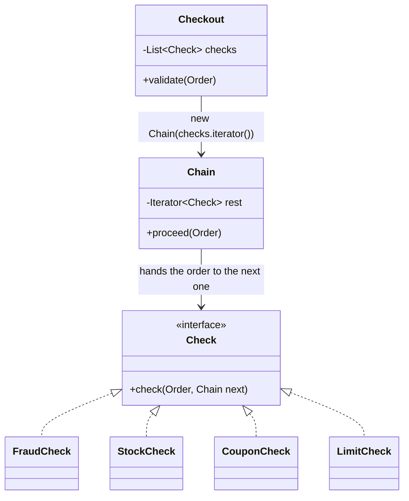

# Chain of Responsibility

**Behavioral** · Episode 4 · [Video](https://youtube.com/shorts/NVseSXuwiDA) ·
[Blog post](https://codevx.dev/post/chain-of-responsibility-pattern-in-java)

> Pass a request along a line of handlers. Each one either stops it or passes it on, and none of them knows what
> comes after it.

## The problem

Before an order is paid it has to pass a fraud, a stock and a coupon check, and any of them can stop it. One
method with an if per rule ([`before/Checkout.java`](src/main/java/dev/codevx/patterns/chain/before/Checkout.java))
works until the risk team wants a spending limit, and you are back in that method:

```java
if (o.risky())        throw new Rejected("fraud");
if (!o.inStock())     throw new Rejected("stock");
if (!o.couponValid()) throw new Rejected("coupon");
if (o.total() > LIMIT) throw new Rejected("limit"); // edit #4
```

The rules can't be reordered, switched off or tested on their own.

## The pattern



A check throws to stop the order, or calls `next.proceed(o)`. It holds the `Chain`, never the check after it, so
checks can be added, dropped or reordered without editing any of them. In Spring, make each check a bean and ask for
a `List<Check>`: Spring hands them over sorted by `@Order`.

## The code

| Folder                                                                 | What it shows                                                                         | Run                                                                       |
| ---------------------------------------------------------------------- | ------------------------------------------------------------------------------------- | ------------------------------------------------------------------------- |
| [`before/`](src/main/java/dev/codevx/patterns/chain/before)            | One `validate()` with an if per rule                                                  | `java src/main/java/dev/codevx/patterns/chain/before/Demo.java`           |
| [`handrolled/`](src/main/java/dev/codevx/patterns/chain/handrolled)    | `Check`, `Chain`, a class per check; and `Rules`, the runner shape (pitfall 1's fix)  | `java src/main/java/dev/codevx/patterns/chain/handrolled/Demo.java`       |
| [`spring/`](src/main/java/dev/codevx/patterns/chain/spring)            | Checks as beans with `@Order`, `Checkout` asking for a `List`, and a servlet filter   | `./mvnw -pl behavioral/chain-of-responsibility spring-boot:run` (from the repo root) |

```text
The checks Spring hands over, in @Order order: [FraudCheck, StockCheck, CouponCheck, LimitCheck]
good order: passed every check
out-of-stock order: stopped by stock
huge order: stopped by limit
```

`LimitCheck` is one more `@Component`; `Checkout` never names it. The same shape is in every Spring web request:
[`TokenFilter`](src/main/java/dev/codevx/patterns/chain/spring/TokenFilter.java) answers `401` and returns when
there's no token, and otherwise calls `chain.doFilter(req, res)`.

Tests: `./mvnw -pl behavioral/chain-of-responsibility test` runs
[`HandRolledTest`](src/test/java/dev/codevx/patterns/chain/HandRolledTest.java),
[`SpringTest`](src/test/java/dev/codevx/patterns/chain/SpringTest.java) and
[`PitfallsTest`](src/test/java/dev/codevx/patterns/chain/PitfallsTest.java).

## Pitfalls

Each one is a test in [`PitfallsTest`](src/test/java/dev/codevx/patterns/chain/PitfallsTest.java): the failure
first, then the fix.

1. **A check that forgets `next.proceed(o)` doesn't fail.** The checks after it never run, and an out-of-stock
   order goes through unchecked. Fix: when no check needs to work after the others, use the runner shape
   ([`Rules`](src/main/java/dev/codevx/patterns/chain/handrolled/Rules.java)): a loop moves the order on, and each
   rule only returns or throws, so none can skip the rest.
2. **The same in a servlet filter.** A filter that forgets `chain.doFilter` ends the request: the controller never
   runs, and the client gets an empty `200`. Fix: end the filter with `chain.doFilter(req, res)`.
3. **Without `@Order`, the `List` follows registration order**, which depends on class scanning: a slow check that
   calls another service can land in front of the cheap one that would have stopped the order. Fix: `@Order` on
   every check, and a test that pins the order
   ([`SpringTest`](src/test/java/dev/codevx/patterns/chain/SpringTest.java) does).

Not in the tests, but worth saying in an interview:

- **`@Order` and a domain class named `Order`** can't both be imported: write the annotation out,
  `@org.springframework.core.annotation.Order(1)`.
- **Stopping by exception or by result.** A rejected order isn't exceptional; a check that returns a result lets the
  caller collect every reason, not only the first.
- **Keep checks independent.** A check that relies on another having run first breaks on the next reorder.

## Often confused with

| Pattern   | The question that separates them                                                                                     |
| --------- | -------------------------------------------------------------------------------------------------------------------- |
| Observer  | Can a receiver stop the request? A listener is only told, after the fact; a handler stands in the way and can say no. |
| Decorator | Does every link call through? A decorator always calls the next one; a handler may stop and never call it.             |
| State     | Who picks the next step? A state names the next state; a handler never knows what comes after it.                     |

## Interview questions

- **Where have you used it?** Servlet filters and Spring Security's `SecurityFilterChain`: each filter can end the
  request with a `401` or `403`, or pass it on. MVC `HandlerInterceptor`s too.
- **How do you add a rule without touching the others?** One more class (a bean, in Spring); the code that runs the
  chain doesn't change.
- **How does Spring know the order?** It sorts a `List` of beans by `@Order` or `Ordered`; beans without either
  come last, in no order you should rely on.
- **Each handler calls the next, or a loop calls each handler?** The first lets a handler work after the rest has
  run (a filter timing a request); the second can't skip a handler by mistake.
- **Fraud, stock and coupon checks, and any of them can stop the order. Observer?** No: an observer is only told
  what happened, so it can't say no. That's a chain.
- **The trap:** you wrap a payment client in a logger, then wrap that in a retry, and each one calls the next. Is
  that another chain? **No:** a wrapper never stops the call; it adds to it. That's a Decorator (episode 5).

## Say it in 30 seconds

"Chain of Responsibility passes a request along a line of handlers, and each one either stops it or passes it on,
without knowing what comes next. So adding, dropping or reordering a rule is one class and no edits. Every Spring web
request runs through one, the filter chain, and for my own checks I make each one a bean and inject a `List`, sorted
by `@Order`. The catch is a handler that forgets to call the next one: everything after it is silently skipped, so
when no handler needs to run after the others, I use a loop instead."

## Spot it in LLD interviews

One request goes down a line of handlers, and any of them can stop it: checkout validation, an ATM's cash
dispenser (100, 50, 20 notes), expense approval (manager, director, CFO), a support desk's levels, a spam filter,
an API gateway (auth, rate limit, validation), log handlers by level. If every step always runs and none can stop
the request, it's a pipeline, not a chain.
