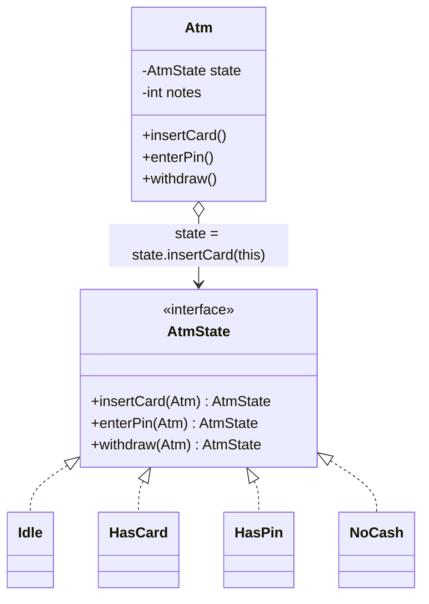
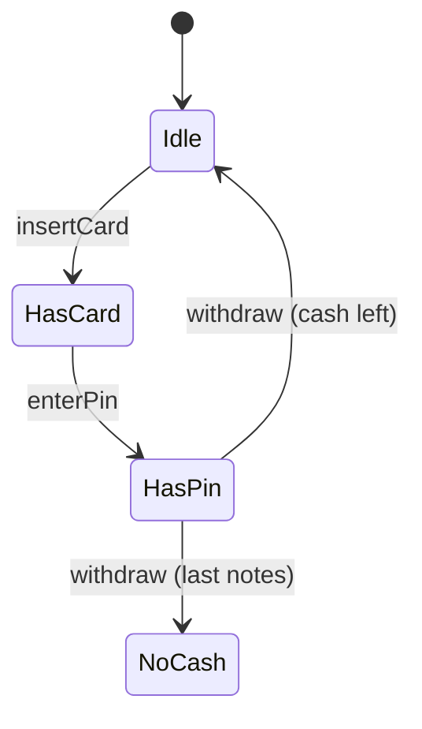

# State

**Behavioral** · Episode 2 · [Video](https://youtube.com/shorts/IPporXbhNcc) ·
[Blog post](https://codevx.dev/post/state-pattern-in-java)

> Give each state of an object its own class. The object hands every call to its current state, and the state
> returns the next one, so the object changes its own behaviour as it moves through its steps.

## The problem

An ATM with one status field and the same if-else in every method
([`before/Atm.java`](src/main/java/dev/codevx/patterns/state/before/Atm.java)). Adding `NO_CASH` means a new
branch in every method, and a missed branch is a bug nobody sees until it runs.

## The pattern

Nobody outside sets the state: **the object moves itself.** That one line, `state = state.insertCard(this)`, is
the difference from Strategy.

## The code

| Folder                                                   | What it shows                                                                                   | Run                                                              |
| -------------------------------------------------------- | ----------------------------------------------------------------------------------------------- | ---------------------------------------------------------------- |
| [`before/`](src/main/java/dev/codevx/patterns/state/before)         | One enum field, the same if-else in three methods                                               | `java src/main/java/dev/codevx/patterns/state/before/Demo.java`     |
| [`handrolled/`](src/main/java/dev/codevx/patterns/state/handrolled) | A class per state, shared instances, data kept in the ATM, refusals that say why                | `java src/main/java/dev/codevx/patterns/state/handrolled/Demo.java` |
| [`enums/`](src/main/java/dev/codevx/patterns/state/enums)           | The production shortcuts: enum constants with their own bodies, and a transition table          | `java src/main/java/dev/codevx/patterns/state/enums/Demo.java`      |
| [`spring/`](src/main/java/dev/codevx/patterns/state/spring)         | The status stored as an enum, its behaviour in stateless beans looked up by status, checked at startup | `./mvnw -pl behavioral/state spring-boot:run` (from the repo root) |

Which one to use: an **enum with a transition table** when the status only gates which moves are allowed;
**constants with bodies** when a few states behave differently; **a class (or bean) per state** when each state
has real behaviour of its own. For large workflows, Spring Statemachine exists, but most order lifecycles don't
need it.

Tests: `./mvnw -pl behavioral/state test` runs [`HandRolledTest`](src/test/java/dev/codevx/patterns/state/HandRolledTest.java)
(including a check that the if-else and the State version agree on every step),
[`SpringTest`](src/test/java/dev/codevx/patterns/state/SpringTest.java) and
[`PitfallsTest`](src/test/java/dev/codevx/patterns/state/PitfallsTest.java).

## Pitfalls

Each one is a test in [`PitfallsTest`](src/test/java/dev/codevx/patterns/state/PitfallsTest.java): the failure
first, then the fix.

1. **Refusing by returning `this`.** The caller gets the same state back with no reason, so it can't tell "not
   allowed" from "worked, nothing changed". Refuse out loud: [`NotAllowed`](src/main/java/dev/codevx/patterns/state/handrolled/NotAllowed.java)
   carries the reason.
2. **A shared state instance that keeps data.** Sharing one `HasCard` across ATMs is right only while it holds
   nothing; a wrong-PIN counter in it would block every ATM. Keep the data in the context (`Atm.notes`) and pass
   the context to the state.
3. **Storing the ordinal.** JPA's default `@Enumerated(ORDINAL)` stores `1` for `PAID`; add `PAYMENT_PENDING` in
   the middle and every old row reads as `PAYMENT_PENDING`. Store the name: `@Enumerated(EnumType.STRING)`.
4. **A status without its state bean fails late**, on the first order that reaches it. Check at startup that every
   status has exactly one bean ([`OrderStates`](src/main/java/dev/codevx/patterns/state/spring/OrderStates.java)).

Not in the tests, but worth saying in an interview:

- **`new HasCard()` on every call** creates garbage for objects with no data. Share one instance per state.
- **Two requests moving the same order at once** can both read `PAID` and both act. Lock the row, or use
  optimistic locking (`@Version`), so one transition wins.
- **Two states and a boolean don't need classes.** An if-else is simpler.

## Often confused with

| Pattern                    | The question that separates them                                                                                   |
| -------------------------- | ------------------------------------------------------------------------------------------------------------------ |
| [Strategy](../strategy)    | Who swaps? State: the object itself, again and again, and a state names the state that follows. Strategy: the caller, once, and strategies don't know each other. |
| Memento                    | Same word, different job: Memento *saves* an object's state to restore it later; State *is* the behaviour of the current step. |

## Interview questions

- **An ATM behaves differently at every step. Strategy?** **No:** it changes on its own. That's State.
- **Who decides the next state?** Here, each state (it returns the next one), which keeps the rules next to the
  behaviour. The alternative is a central transition table in the context, easier to see at a glance. Say which
  you chose and why.
- **How do you add a state?** One new class, plus a change to the states that lead to it (here only `HasPin`
  knows `NoCash`).
- **How do you store it?** As the enum's name in a column; the behaviour hangs off the enum or a bean per value.
- **The trap:** an order just got paid, and email, inventory and analytics need to know. Should the order call
  them? **No:** it announces, they listen: [Observer](../observer).

## Say it in 30 seconds

"State gives each step of an object's lifecycle its own class behind one interface. The object delegates every
call to its current state, and the state returns the next one, so there's no if-else on a status field and a new
state is a new class. It looks like Strategy, but in Strategy the caller picks once; in State the object moves
itself. For a simple order status I'd use an enum with a transition table and store the name, not the ordinal."

## Spot it in LLD interviews

The requirements read like a lifecycle ("first…, then…, only after…, can't… once…") and the same action does
different things at different steps: vending machine (idle, has coin, dispensing, sold out), elevator car, traffic
light, seat booking (available, held, booked), food delivery, document approval.
