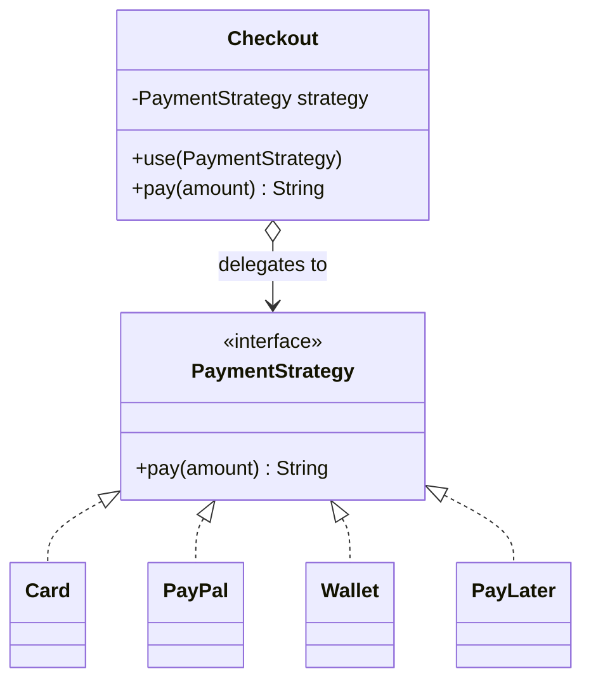

# Strategy

**Behavioral** · Episode 1 · [Video](https://youtube.com/shorts/5QN0onacLTc) ·
[Blog post](https://codevx.dev/post/strategy-pattern-in-java)

> Put each way of doing a job in its own class behind one interface. The code that uses it holds the interface,
> so a new way is a new class, not an edit.

## The problem

A checkout with one branch per payment type ([`before/Checkout.java`](src/main/java/dev/codevx/patterns/strategy/before/Checkout.java)).
Adding PayLater means editing the method again, and every edit can break the branches that already worked.

```java
if (type == Type.CARD) { ... }
else if (type == Type.PAYPAL) { ... }
else if (type == Type.WALLET) { ... }
else if (type == Type.PAY_LATER) { ... } // the edit every new type needs
```

## The pattern



The **caller** picks the strategy (or Spring does, once). The context never asks which one it holds.

## The code

| Folder                                                       | What it shows                                                        | Run                                    |
| ------------------------------------------------------------ | -------------------------------------------------------------------- | -------------------------------------- |
| [`before/`](src/main/java/dev/codevx/patterns/strategy/before)         | The if-else checkout                                                 | `java src/main/java/dev/codevx/patterns/strategy/before/Demo.java` |
| [`handrolled/`](src/main/java/dev/codevx/patterns/strategy/handrolled) | Interface, four strategies, a context that swaps them, and a lambda as a strategy | `java src/main/java/dev/codevx/patterns/strategy/handrolled/Demo.java` |
| [`jdk/`](src/main/java/dev/codevx/patterns/strategy/jdk)               | `Comparator`: the strategy you already use with `List.sort`          | `java src/main/java/dev/codevx/patterns/strategy/jdk/SortDemo.java` |
| [`spring/`](src/main/java/dev/codevx/patterns/strategy/spring)         | Spring injects `Map<String, PaymentStrategy>`; PayLater is one new `@Component` | `./mvnw -pl behavioral/strategy spring-boot:run` (from the repo root) |

Tests: `./mvnw -pl behavioral/strategy test` runs [`HandRolledTest`](src/test/java/dev/codevx/patterns/strategy/HandRolledTest.java),
[`SpringTest`](src/test/java/dev/codevx/patterns/strategy/SpringTest.java) and
[`PitfallsTest`](src/test/java/dev/codevx/patterns/strategy/PitfallsTest.java).

## Pitfalls

Each one is a test in [`PitfallsTest`](src/test/java/dev/codevx/patterns/strategy/PitfallsTest.java): the failure
first, then the fix.

1. **An unknown key is a `NullPointerException`.** `map.get("upi")` returns `null`, and the NPE on the next line
   says nothing about the type. Check the lookup and fail with the type and the known ones.
2. **The map key is the bean name, and the bean name is the class name.** Rename `PayLater` to `BuyNowPayLater` and
   every caller sending `"payLater"` breaks. When the key comes from a request or a database row, name the bean:
   `@Component("pay-later")`.
3. **Strategy beans are singletons.** One instance serves every request, so a field written inside `pay()` leaks
   between requests. Keep strategies stateless.
4. **Two cases that never change don't need it.** An interface and two classes for a fixed if-else is noise.

## Often confused with

| Pattern                                                   | The question that separates them                                                                 |
| --------------------------------------------------------- | ------------------------------------------------------------------------------------------------ |
| [State](../state)                                         | Who swaps the behaviour? Strategy: the caller, once. State: the object itself, again and again.  |
| Template Method                                           | Strategy swaps a whole object (composition, at runtime); Template Method overrides one step of a parent's fixed algorithm (inheritance, at compile time). |
| Command                                                   | A strategy is *how* to do a job now; a command is a request packaged to run later, queue or undo. |

## Interview questions

- **Add PayLater without touching existing code. How?** One new class implementing `PaymentStrategy`; in Spring, a
  new `@Component`, and the map gains a `"payLater"` entry. `Checkout` is closed for modification and open for
  extension.
- **Where have you used it?** `Comparator` with `List.sort`; `RejectedExecutionHandler` on a `ThreadPoolExecutor`;
  Spring Security's `PasswordEncoder` implementations; any `Map<String, SomeStrategy>` injection.
- **How does Spring pick one at runtime?** By key from an injected `Map<String, Bean>` (bean name is the key), or
  from a `List<Bean>` where each strategy answers `supports(type)`.
- **Is a lambda a strategy?** Yes, when the interface has one method: `checkout.use(amount -> ...)`.
- **The trap:** an ATM changes behaviour at every step. Strategy? **No:** the ATM changes itself, so it's
  [State](../state).

## Say it in 30 seconds

"Strategy puts each version of an algorithm behind one interface. The context holds the interface and delegates,
so a new version is a new class and the context never changes. The caller, or the DI container, picks which one.
`Comparator` is the JDK's example; in Spring I inject a `Map<String, PaymentStrategy>` and look it up by key, with a
clear error for an unknown key. With two cases that never change, I'd keep the if-else."

## Spot it in LLD interviews

Many ways to do the same job, and new ones keep arriving: parking-lot pricing (hourly, flat, weekend), elevator
dispatch (nearest car, SCAN), ride fares (standard, surge), cart discounts, bill splitting (equal, exact,
percent), rate limiting (token bucket, sliding window).
