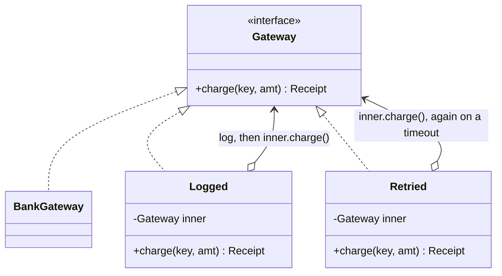

# Decorator

**Structural** · Episode 5 · [Video](https://youtube.com/shorts/RdtUKvyH8i8) ·
[Blog post](https://codevx.dev/post/decorator-pattern-in-java)

> Wrap an object in another with the same interface to add one job around its calls. The wrapper always calls
> through, and wrappers stack in any order at runtime.

## The problem

A payment client needs logging, retries, and later metrics. The first try is a subclass per extra
([`before/`](src/main/java/dev/codevx/patterns/decorator/before)): one that logs, one that retries, and one more
that does both, copying the other two because Java has one superclass.

```java
class LoggingGateway         extends BankGateway {}
class RetryingGateway        extends BankGateway {}
class LoggingRetryingGateway extends BankGateway {}
```

Three extras make seven classes, a fourth makes fifteen, and each combination and its order is fixed when you
compile.

## The pattern



Each extra is one wrapper, so three extras are three classes, and any stack is one line of wiring:
`new Logged(new Retried(new BankGateway()))`. The caller holds a `Gateway` and can't tell how many wrappers it is
talking to. The video's `Gateway` is `charge(long amt)`; here it takes an idempotency key too, because a retried
charge needs one (pitfall 2).

## The code

| Folder                                                                   | What it shows                                                                    | Run                                                                    |
| ------------------------------------------------------------------------ | -------------------------------------------------------------------------------- | ---------------------------------------------------------------------- |
| [`before/`](src/main/java/dev/codevx/patterns/decorator/before)          | A subclass for every combination of extras                                       | `java src/main/java/dev/codevx/patterns/decorator/before/Demo.java`    |
| [`handrolled/`](src/main/java/dev/codevx/patterns/decorator/handrolled)  | `Logged` and `Retried`, stacked both ways, with and without a key                | `java src/main/java/dev/codevx/patterns/decorator/handrolled/Demo.java` |
| [`jdk/`](src/main/java/dev/codevx/patterns/decorator/jdk)                | Stacked `java.io` streams, `synchronizedList`, and `unmodifiableList` (a proxy)  | `java src/main/java/dev/codevx/patterns/decorator/jdk/Demo.java`       |
| [`spring/`](src/main/java/dev/codevx/patterns/decorator/spring)          | The stack built once in a `@Bean` method, marked `@Primary`                      | `./mvnw -pl structural/decorator spring-boot:run` (from the repo root) |

The Spring demo's bank loses the reply to every payment's first try, so the card is charged but the caller sees a
timeout:

```text
The Gateway Checkout gets: Logged(Retried(BankGateway))
log: charge 4900 for order-41
bank: charged 4900 for order-41, reply lost
bank: order-41 again, no new charge
paid: Receipt[key=order-41, amt=4900]
the card was charged 1 time for order-41
```

Tests: `./mvnw -pl structural/decorator test` runs
[`HandRolledTest`](src/test/java/dev/codevx/patterns/decorator/HandRolledTest.java),
[`SpringTest`](src/test/java/dev/codevx/patterns/decorator/SpringTest.java) and
[`PitfallsTest`](src/test/java/dev/codevx/patterns/decorator/PitfallsTest.java).

## Pitfalls

Each one is a test in [`PitfallsTest`](src/test/java/dev/codevx/patterns/decorator/PitfallsTest.java): the failure
first, then the fix.

1. **The order of the wrappers changes what happens.** `Retried(Logged(bank))` logs every try;
   `Logged(Retried(bank))` logs each charge once. Neither is wrong, so choose. Metrics follow the same rule: inside
   the retry they count attempts, outside they count charges.
2. **A retry without an idempotency key charges twice.** A charge that timed out may have gone through, and only the
   reply was lost. Fix: make one key per payment, outside the retry, and send it on every try; the bank returns the
   first result for a key it has seen (Stripe's `Idempotency-Key` header).
3. **Without `@Primary`, the parameter name picks the bean.** `BankGateway` is a `Gateway` bean too, so Spring has
   two. It falls back to matching the parameter name: `Gateway paymentGateway` fails at startup with
   `NoUniqueBeanDefinitionException`, and `Gateway bankGateway` silently gets the plain client, with no logging and
   no retry. Fix: `@Primary` on the stack
   ([`GatewayConfig`](src/main/java/dev/codevx/patterns/decorator/spring/GatewayConfig.java)).

Not in the tests, but worth saying in an interview:

- **A wrapped gateway is not a `BankGateway`.** `instanceof` and casts to the concrete class fail on the outer
  wrapper; code that needs the concrete type should hold the interface.
- **Keep stacks shallow.** Every wrapper adds a frame to each stack trace; past three or four, look for a pipeline
  or a framework feature.
- **Don't wrap what is always on.** If every call must be logged, put it in the class: a wrapper is for extras that
  come and go.

## Often confused with

| Pattern                 | The question that separates them                                                                                      |
| ----------------------- | --------------------------------------------------------------------------------------------------------------------- |
| Chain of Responsibility | Does every link call through? A decorator always calls the next one; a handler in a chain may stop the request.        |
| Proxy                   | Does it decide whether the call happens? A decorator adds behaviour and always calls through; a proxy controls access. |
| Adapter                 | Does the interface change? A decorator keeps it; an adapter converts one interface into another.                       |

## Interview questions

- **Where is it in the JDK?** `java.io`: `new GZIPInputStream(new BufferedInputStream(new FileInputStream(f)))`;
  both wrappers extend `FilterInputStream`. Also `Collections.synchronizedList`. `Collections.unmodifiableList`
  refuses writes, so it is a proxy, and `InputStreamReader` changes the interface, so it is an adapter.
- **Where is it in Spring?** A `@Bean` method that returns the stack; `TaskDecorator`, which wraps every task an
  executor runs (usually to copy the MDC onto the `@Async` thread); `HttpServletRequestWrapper` subclasses such as
  `ContentCachingRequestWrapper`.
- **Why not subclasses?** One class per combination, fixed at compile time. Wrappers are one class per extra,
  combined at runtime.
- **Pizza toppings: decorator or a `List<Topping>`?** If toppings only add a price, a list and a sum are simpler.
  A decorator earns its place when each extra changes what happens around the call.
- **A logger wraps a payment client, a retry wraps that, each one calls the next. A chain?** No: a handler in a
  chain can stop the request, and a wrapper never does. That's Decorator.
- **The trap:** a debit card stands in for your bank account, but it checks your PIN and your limit before any
  money moves. Is that Decorator? **No:** it decides whether the call reaches the account at all. That's a Proxy
  (episode 6).

## Say it in 30 seconds

"A decorator wraps an object in another with the same interface and adds one job around the call, like logging or
a retry, then always calls through. Each extra is one class, and you stack them at runtime in any order, so three
extras don't need seven subclasses. Java's streams work this way, and in Spring I build the stack once in a `@Bean`
method and mark it `@Primary`, because the plain client is a bean too. Two things to watch: the order of the
wrappers changes what's logged or counted, and a retried payment needs an idempotency key."

## Spot it in LLD interviews

Extras that can be added in any combination, around a core that keeps its interface: a payment or API client
(logging, retry, metrics, auth headers), file storage (compression, encryption, buffering), a text editor's
formatting (bold, italic, underline), pizza or coffee extras, a game character's power-ups.
