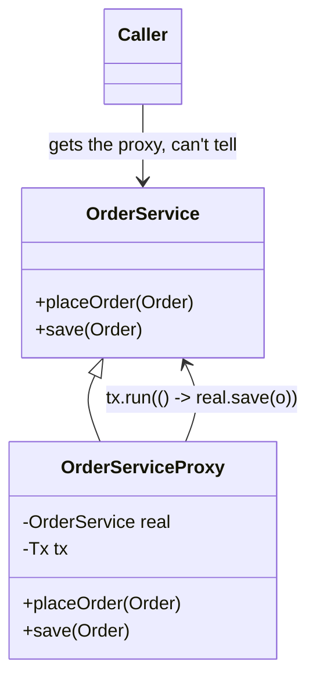

# Proxy

**Structural** · Episode 6 · [Video](https://youtube.com/shorts/V4Af8c32bY0) ·
[Blog post](https://codevx.dev/post/proxy-pattern-in-java)

> A stand-in with the same interface as the real object, which controls access to it: it decides if, when and how
> the call reaches the real thing.

## The problem

Every method that must be all-or-nothing carries its own transaction lines
([`before/OrderService.java`](src/main/java/dev/codevx/patterns/proxy/before/OrderService.java)): two lines of work,
seven of plumbing, in every such method of every service.

```java
tx.begin();
try {
  orders.insert(o);
  stock.reserve(o);
  tx.commit();
} catch (RuntimeException e) {
  tx.rollback();
  throw e;
}
```

## The pattern



Callers hold an `OrderService` and get the proxy. In Spring you write none of it: `@Transactional` on `save()` and
Spring generates the subclass at startup (`OrderService$$SpringCGLIB$$0`). Spring Boot always proxies the class;
for an interface nobody implements, such as a Spring Data repository, it hands out a JDK dynamic proxy instead.

## The code

| Folder                                                                   | What it shows                                                                                   | Run                                                                   |
| ------------------------------------------------------------------------ | ----------------------------------------------------------------------------------------------- | --------------------------------------------------------------------- |
| [`before/`](src/main/java/dev/codevx/patterns/proxy/before)              | The transaction lines written out in every method                                               | `java src/main/java/dev/codevx/patterns/proxy/before/Demo.java`       |
| [`handrolled/`](src/main/java/dev/codevx/patterns/proxy/handrolled)      | The subclass Spring would generate, written by hand, and the call from inside that skips it     | `java src/main/java/dev/codevx/patterns/proxy/handrolled/Demo.java`   |
| [`spring/`](src/main/java/dev/codevx/patterns/proxy/spring)              | `@Transactional` on a real database (in-memory H2), a Spring Data repository, the trap and the fix | `./mvnw -pl structural/proxy spring-boot:run` (from the repo root) |

The Spring demo prints what you actually get injected, then the same failed stock call three ways:

```text
The OrderService you get: OrderService$$SpringCGLIB$$0
The OrderRepository you get: jdk.proxy2.$Proxy102
save(lamp), called from outside: out of stock: lamp, saved orders: []
placeOrder(lamp), save() called from inside: out of stock: lamp, saved orders: [Order(lamp)]
fixed placeOrder(lamp), through OrderWriter: out of stock: lamp, saved orders: []
```

Tests: `./mvnw -pl structural/proxy test` runs
[`HandRolledTest`](src/test/java/dev/codevx/patterns/proxy/HandRolledTest.java),
[`SpringTest`](src/test/java/dev/codevx/patterns/proxy/SpringTest.java) and
[`PitfallsTest`](src/test/java/dev/codevx/patterns/proxy/PitfallsTest.java).

## Pitfalls

Each one is a test in [`PitfallsTest`](src/test/java/dev/codevx/patterns/proxy/PitfallsTest.java): the failure
first, then the fix.

1. **A call from inside skips the proxy.** `placeOrder()` calls `save()` on `this`, the real object, so
   `@Transactional` does nothing: the repository commits the order at once, the stock call fails, and half the
   order stays saved. Fix: move `save()` to another bean
   ([`OrderWriter`](src/main/java/dev/codevx/patterns/proxy/spring/OrderWriter.java)), so the call crosses its proxy.
2. **The same goes for every annotation a proxy implements.** An `@Async` method called from inside runs on the
   caller's thread; through the proxy it runs on another one.
3. **A `final` method can't be overridden by the generated subclass**, so a `final @Transactional` method runs with
   no transaction. It runs on the proxy object itself, whose fields are empty, so one that uses a field fails with
   a `NullPointerException`.

Not in the tests, but worth saying in an interview:

- **`@Cacheable` and `@PreAuthorize` called from inside** skip the cache and the permission check, for the same
  reason as pitfall 2.
- **Other fixes for pitfall 1**, from best to last resort: `TransactionTemplate` for the one block that needs it;
  injecting the bean into itself (`@Lazy` self-reference); AspectJ weaving, which changes the class instead of
  wrapping it.
- **Hibernate's lazy proxies.** A `@ManyToOne(fetch = LAZY)` field holds a proxy that queries on first access;
  touch it after the transaction ends and you get `LazyInitializationException`.

## Often confused with

| Pattern   | The question that separates them                                                                                          |
| --------- | ------------------------------------------------------------------------------------------------------------------------- |
| Decorator | Does it decide whether the call happens? A decorator adds behaviour and always calls through; a proxy controls access, and the container usually puts it there, not your code. |
| Adapter   | Does the interface change? A proxy has the same interface as the real thing; an adapter converts one interface into another. |

## Interview questions

- **How does `@Transactional` work?** Spring hands out a proxy that begins a transaction, calls the real method,
  then commits, or rolls back on a runtime exception.
- **Why does `@Transactional` do nothing when a method calls another method of the same class?** The call goes to
  `this`, the real object, not the proxy. Move the method to another bean.
- **JDK dynamic proxy or CGLIB?** A JDK proxy implements interfaces; CGLIB generates a subclass, so it can't
  intercept `final` or `private` methods. Spring Boot uses CGLIB by default.
- **Where else have you used a proxy?** Spring Data repositories, Hibernate lazy loading, `@Cacheable`, `@Async`,
  `@PreAuthorize`, and the client stubs of remote calls.
- **A debit card checks your PIN and limit before any money moves. Decorator or Proxy?** Proxy: it can turn the
  call away. A decorator always passes it on.
- **The trap:** a bank's SDK doesn't match your payment interface, so you wrap it in a class that does. Is that a
  Proxy? **No:** a proxy keeps the interface; this one changes it. That's an Adapter (episode 7).

## Say it in 30 seconds

"A proxy stands in for the real object behind the same interface, so callers can't tell, and it controls access:
it can load the object lazily, check permissions, answer from a cache, make a remote call, or run the method in a
transaction. Spring is built on them: `@Transactional`, `@Async` and `@Cacheable` are proxies, and so are Spring
Data repositories. The catch is that the proxy only sees calls that come through it, so a method calling another
method of the same class skips the transaction; I move that method to another bean."

## Spot it in LLD interviews

Callers keep the same interface, but something has to happen before the real object is reached: load it, check a
permission, look in a cache, cross the network, open a transaction. Image viewers (load on draw), document sharing
(role checks), pricing services (cache), payment API clients (remote), rate-limited APIs (count and refuse), ORMs
(lazy relations), and every service layer with transactions.
